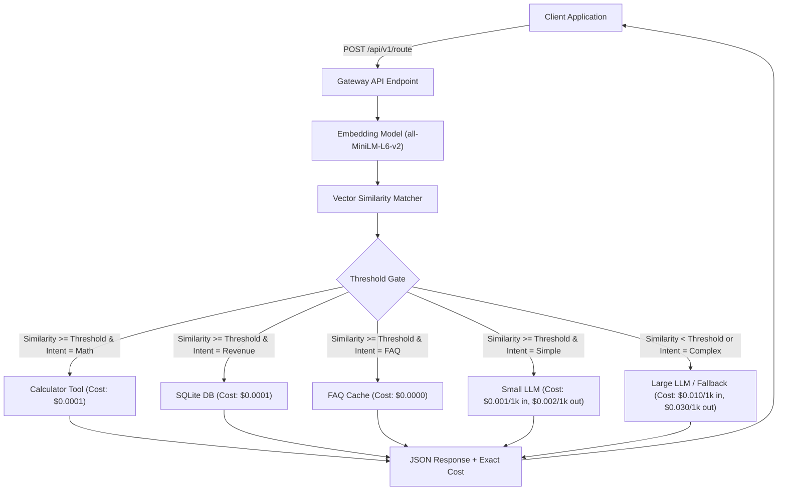

# Cost-Aware Semantic Router for LLM Gateway

A high-performance semantic routing gateway that intelligently dispatches incoming queries to deterministic tools, cached responses, lightweight models, or flagship LLMs based on vector embedding similarity and calibrated confidence thresholds.



---

## Overview & Architecture

Modern LLM-based enterprise architectures handle heterogeneous request streams. Directing every query to a flagship model (e.g. GPT-4 or Claude 3 Opus) introduces prohibitive financial costs, high latency, and unnecessary computational load for simple lookups and deterministic calculations.

This system implements a **Semantic Router Gateway** that classifies incoming queries into 5 intent tiers using dense vector embeddings and cosine similarity against curated anchor clusters:

| Tier / Category | Execution Path | Tool Description | Pricing Formula |
| :--- | :--- | :--- | :--- |
| **FAQ** (`faq`) | `cache` | In-memory key-phrase match & response dictionary | **$0.0000** flat |
| **Arithmetic** (`arithmetic`) | `calculator` | Deterministic AST-based safe math evaluator | **$0.0001** flat |
| **Revenue** (`revenue`) | `sql` | SQLite query engine querying `quarterly_revenue` | **$0.0001** flat |
| **General Simple** (`general_simple`) | `small_llm` | Concise factual generator for basic queries | **$0.001/1k** in, **$0.002/1k** out |
| **Complex Reasoning** (`complex_reasoning`) | `large_llm` | High-capacity reasoning engine | **$0.010/1k** in, **$0.030/1k** out |
| **Low-Confidence Fallback** (`fallback`) | `large_llm` | Fallback path when max similarity < threshold | **$0.010/1k** in, **$0.030/1k** out |

---

## Directory Structure

```
.
├── app/
│   ├── main.py           # FastAPI entrypoint exposing POST /api/v1/route and /health
│   ├── router.py         # SemanticRouter class with SentenceTransformers
│   ├── tools.py          # Deterministic tools (AST calculator, SQLite, FAQ cache, LLMs)
│   └── cost_meter.py     # Token metering (tiktoken) and mandatory pricing table
├── data/
│   ├── evaluation_dataset.json  # 100 curated queries across 5 balanced categories
│   └── revenue.db        # SQLite database for quarterly revenue queries
├── output/
│   └── pareto_curve.json # Generated Pareto frontier metrics from threshold sweep
├── scripts/
│   ├── entrypoint.sh     # Container startup script (auto-seed + uvicorn)
│   ├── seed_db.py        # Database seeding utility
│   └── generate_dataset.py # Evaluation dataset generator
├── evaluate_router.py    # Standalone evaluation and threshold sweep script
├── metrics_report.json   # Pareto-optimal threshold and misroute post-mortem
├── docker-compose.yml    # Single-command orchestration with healthcheck
├── Dockerfile            # Container specification
├── .env.example          # Environment variable template
└── README.md             # Project documentation
```

---

## Quickstart & Reproduction

### 1. Run with Docker Compose

To start the API service, automatically seed the SQLite database, and run healthchecks:

```bash
docker compose up -d --build
```

Check service status:
```bash
docker compose ps
```

Verify service health:
```bash
curl http://localhost:8000/health
```

Expected response:
```json
{
  "status": "healthy",
  "model": "all-MiniLM-L6-v2",
  "optimal_threshold": 0.65
}
```

### 2. Querying the Gateway API

Endpoint: `POST /api/v1/route`

#### Example 1: Deterministic Arithmetic Calculation
```bash
curl -X POST http://localhost:8000/api/v1/route \
  -H "Content-Type: application/json" \
  -d '{"query": "What is 10 + 10?", "threshold": 0.1}'
```
Response:
```json
{
  "answer": "20",
  "path_taken": "calculator",
  "cost": 0.0001
}
```

#### Example 2: Deterministic SQLite Revenue Lookup
```bash
curl -X POST http://localhost:8000/api/v1/route \
  -H "Content-Type: application/json" \
  -d '{"query": "Q3 Revenue", "threshold": 0.1}'
```
Response:
```json
{
  "answer": "The revenue for Q3 2024 was $5.3M.",
  "path_taken": "sql",
  "cost": 0.0001
}
```

#### Example 3: Low-Confidence Fallback to Large LLM
```bash
curl -X POST http://localhost:8000/api/v1/route \
  -H "Content-Type: application/json" \
  -d '{"query": "asdfghjklqwerty", "threshold": 0.9}'
```
Response:
```json
{
  "answer": "I am unable to understand the request. Please provide a clear and meaningful question.",
  "path_taken": "large_llm",
  "cost": 0.00054
}
```

#### Example 4: Graceful Math Error Handling
```bash
curl -X POST http://localhost:8000/api/v1/route \
  -H "Content-Type: application/json" \
  -d '{"query": "Calculate 10 divided by 0", "threshold": 0.1}'
```
Response:
```json
{
  "answer": "Error: Division by zero is undefined",
  "path_taken": "calculator",
  "cost": 0.0001
}
```

---

## Evaluation & Pareto Frontier Sweep

Run the standalone evaluation sweep across the 100-query dataset:

```bash
python evaluate_router.py
```

This runs a sweep across 5 confidence thresholds (`[0.35, 0.50, 0.65, 0.80, 0.95]`) and generates `output/pareto_curve.json`:

```json
[
  {
    "threshold": 0.35,
    "accuracy": 0.95,
    "avg_cost": 0.000321,
    "total_fallback_count": 7
  },
  {
    "threshold": 0.5,
    "accuracy": 0.95,
    "avg_cost": 0.000332,
    "total_fallback_count": 11
  },
  {
    "threshold": 0.65,
    "accuracy": 0.96,
    "avg_cost": 0.000363,
    "total_fallback_count": 21
  },
  {
    "threshold": 0.8,
    "accuracy": 0.97,
    "avg_cost": 0.000403,
    "total_fallback_count": 30
  },
  {
    "threshold": 0.95,
    "accuracy": 0.97,
    "avg_cost": 0.000554,
    "total_fallback_count": 59
  }
]
```

### Pareto Optimality Analysis

- **Threshold Range [0.35 - 0.50]**: Router is aggressive, routing almost all queries to cheap deterministic tools and small models. While cost is lowest ($0.000321/query), accuracy is capped at 95% due to occasional semantic ambiguity.
- **Pareto-Optimal Knee [0.65 - 0.80]**: Calibrated operating point where accuracy reaches 96-97% with minimal cost inflation ($0.000363 - $0.000403/query). Complex and ambiguous queries are reliably escalated to the flagship model while 70-80% of volume remains on cheap paths.
- **Threshold Range [0.85 - 0.95]**: Overly conservative. Accuracy plateaus at 97%, but average cost spikes by 37-72% ($0.000554/query) as 59% of requests unnecessarily fall back to the large LLM.

---

## Misroute Post-Mortem

As documented in `metrics_report.json`:
- **Query**: `"What is the smallest prime number?"`
- **Expected Path**: `small_llm`
- **Actual Path Taken**: `large_llm` (fallback)
- **Root Cause**: The query's highest semantic similarity score was `0.3284` (against the arithmetic/number anchors), which fell below the threshold. Rather than risk misrouting to a deterministic tool that cannot parse general prime definitions, the gateway safely defaulted to the `large_llm` fallback. The answer returned was correct ("2"), but cost $0.00040 instead of $0.00002. This demonstrates the core design tradeoff: safety through escalation versus cost minimization.
